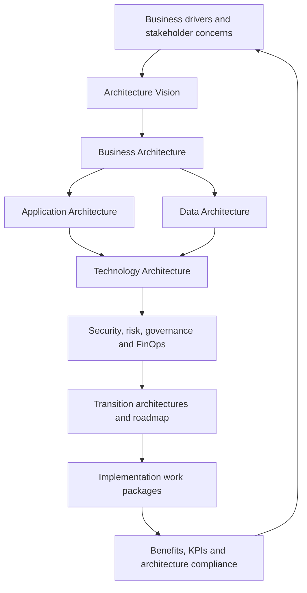

# Enterprise Architecture Blueprint

A practical, vendor-neutral Enterprise Architecture case study connecting business strategy, capabilities, processes, applications, data, technology, governance, and transformation planning.

> **Portfolio status:** illustrative reference case study. The organization, capabilities, requirements, and target state in this folder are fictional examples created for learning and portfolio demonstration. They are not a client implementation and do not claim measured business outcomes.

## Objective

Demonstrate how an Enterprise Architect moves from business drivers and stakeholder concerns to a coherent current-state assessment, target architecture, architecture decisions, and an incremental transformation roadmap.

## Frameworks and notations

- **TOGAF:** architecture development method, content, governance, and transformation planning concepts.
- **ArchiMate:** business, application, technology, strategy, and implementation viewpoints.
- **BPMN 2.0:** business process modeling.
- **Architecture Decision Records (ADRs):** rationale, alternatives, and consequences.
- **Capability-based planning:** connect business outcomes to capabilities and change initiatives.

This is a practical application of concepts, not a claim of official TOGAF or ArchiMate certification.

## Case-study scenario

A fictional enterprise wants to improve customer experience, process efficiency, data quality, and technology resilience while modernizing a hybrid application landscape and introducing governed AI capabilities.

### Illustrative business drivers

1. Improve customer and employee experience.
2. Reduce process friction and manual handoffs.
3. Improve data quality, access, and governance.
4. Increase platform resilience and security.
5. Improve visibility into technology cost and business value.
6. Adopt AI responsibly where measurable business value exists.

## Architecture package

| Artifact | Purpose |
|---|---|
| [Architecture Vision](docs/01-architecture-vision.md) | Context, drivers, stakeholders, scope, principles |
| [Business Architecture](docs/02-business-architecture.md) | Capabilities, value streams, process model |
| [Application Architecture](docs/03-application-architecture.md) | Application portfolio, integration patterns |
| [Data Architecture](docs/04-data-architecture.md) | Data domains, governance, lifecycle |
| [Technology Architecture](docs/05-technology-architecture.md) | Cloud, platform, security, resilience |
| [Governance and Roadmap](docs/06-governance-and-roadmap.md) | Decision rights, controls, transition states |
| [Architecture Decisions](docs/adr/) | Traceable design decisions |

## End-to-end architecture flow

## How to use this case study

1. Review the fictional scenario and explicitly stated assumptions.
2. Trace each target-state component back to a business driver.
3. Review architecture principles and ADRs.
4. Challenge the target architecture and document trade-offs.
5. Adapt the models to a real organization only after discovery and stakeholder validation.

## Limitations

- No real client environment, inventory, stakeholder interviews, or production data are included.
- No financial benefits or performance improvements are claimed.
- The architecture is conceptual; implementation choices require security, regulatory, procurement, and operational validation.
- Diagrams are explanatory models, not a substitute for a full enterprise architecture repository.

## Author

**Jorge Rodriguez** — Enterprise Systems Engineer | Cloud & Solutions Architecture | Multicloud | AI

- [LinkedIn](https://www.linkedin.com/in/jorge-rodriguez-n/)
- [GitHub](https://github.com/jorge2026)
