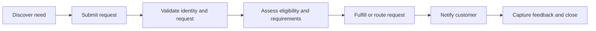
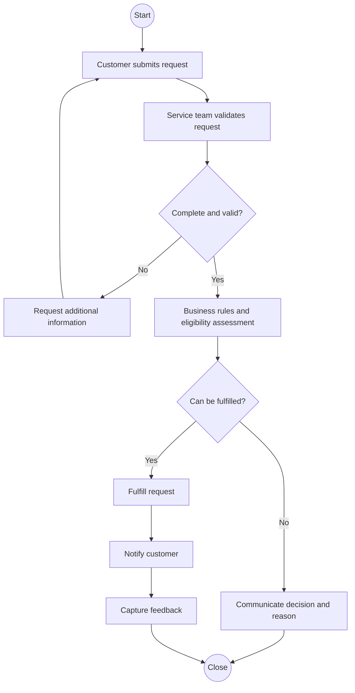

# 02 — Business Architecture

## 1. Illustrative capability map

The capability map is a level-one/level-two reference. Capability ownership and maturity must be validated in a real organization.

| Domain | Level 1 capability | Example level 2 capabilities |
|---|---|---|
| Strategy and governance | Strategy management | Strategic planning, performance management, investment governance |
| Customer | Customer management | Customer onboarding, identity, service, feedback |
| Product and service | Product lifecycle | Product design, pricing, catalog, service fulfillment |
| Operations | Service operations | Case management, order/service fulfillment, incident handling |
| Finance | Financial management | Billing, payments, accounting, budgeting |
| People | Workforce management | Hiring, onboarding, learning, workforce planning |
| Data and analytics | Information management | Data ownership, quality, reporting, analytics |
| Technology | Technology management | Architecture, platform engineering, cybersecurity, IT service management |
| Risk and compliance | Risk management | Enterprise risk, privacy, audit, regulatory obligations |

## 2. Illustrative value stream: customer request to resolution

### Example business outcomes

- Fewer avoidable handoffs.
- Clear ownership at each process stage.
- Consistent status visibility.
- Better data quality at the point of capture.
- Appropriate escalation and auditability.

These are target outcomes to evaluate, not achieved benefits.

## 3. BPMN-style collaboration model

The following simplified BPMN-inspired flow highlights the participants and decisions. It is a conceptual flow, not a formally validated BPMN interchange model.

## 4. Business rules and controls

- Every request has a unique reference and accountable owner.
- Required data is validated before downstream processing.
- Decisions are traceable to approved business rules.
- Exceptions have defined queues, service targets, and escalation paths.
- Customer communications use approved channels and templates.
- Sensitive information is handled according to data classification and privacy requirements.

## 5. Questions for a real architecture engagement

1. Which value streams create the most customer and business value?
2. Where are the longest delays and repeated manual handoffs?
3. Which capabilities are differentiating versus commodity?
4. Who owns each capability, process, and business rule?
5. Which KPIs are available, trusted, and actionable?
