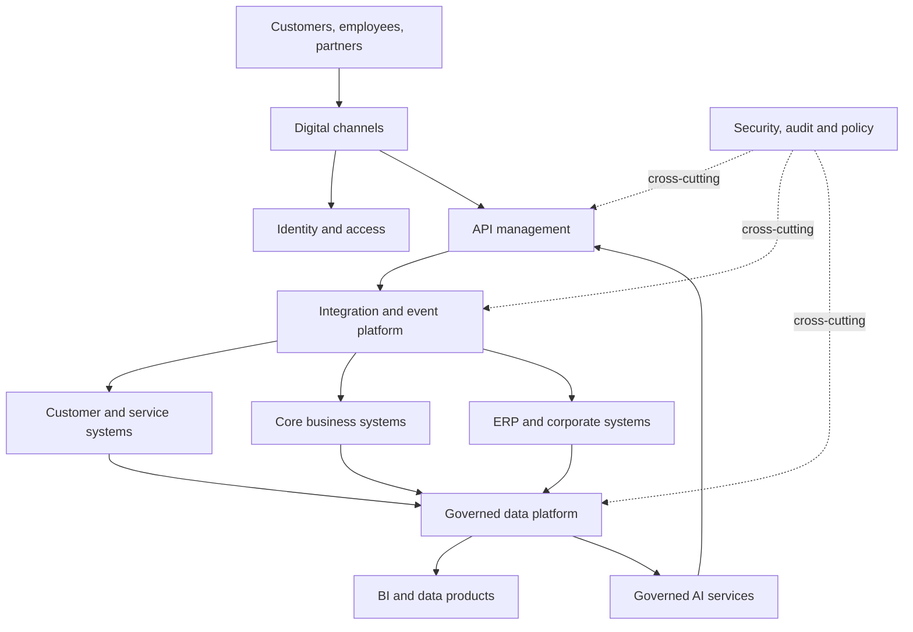

# 03 — Application Architecture

## 1. Conceptual application landscape

The following logical building blocks are illustrative. They are not a verified inventory of any real organization or a commitment to specific products.

| Application domain | Responsibility | Key interfaces |
|---|---|---|
| Digital channels | Web, mobile, partner and employee experiences | HTTPS APIs, identity federation |
| Customer and service management | Customer profile, cases, service requests | REST APIs, events |
| Core business systems | Transaction processing and operational records | APIs, events, controlled batch |
| ERP and corporate systems | Finance, procurement, workforce | Vendor APIs, integration services |
| Integration platform | API management, event routing, orchestration | REST, event messaging |
| Data and analytics | Reporting, semantic models, data products | Governed data pipelines |
| AI services | Approved AI capabilities and workflow assistance | Governed APIs, retrieval interfaces |
| Identity and security | Authentication, authorization, policy enforcement | OIDC, OAuth 2.0, SCIM where applicable |

## 2. Target logical view

## 3. Integration principles

- Prefer managed, versioned APIs for synchronous request/response interactions.
- Use event-driven integration for decoupled business events and asynchronous workflows.
- Use batch integration only where latency and business constraints permit.
- Avoid direct database coupling between independently owned applications.
- Define canonical data contracts only where they reduce meaningful integration complexity.
- Apply authentication, authorization, schema validation, rate limits, and observability at integration boundaries.

## 4. Application portfolio assessment

Assess each application using a consistent set of dimensions:

- Business criticality and capability support.
- Functional fit and user experience.
- Technical health, supportability, and lifecycle.
- Integration complexity and data ownership.
- Security, privacy, and regulatory exposure.
- Availability, recovery, and operational support.
- Total cost of ownership and vendor dependency.

A disposition such as invest, tolerate, modernize, replace, or retire should follow evidence and stakeholder validation.

## 5. AI application guardrails

- Define an accountable business owner and intended use.
- Classify data before it is sent to a model or retrieval system.
- Use approved model endpoints and controlled integration paths.
- Evaluate output quality, safety, bias, and failure modes for the use case.
- Keep human review for consequential decisions as required by risk assessment.
- Monitor model usage, latency, errors, and cost.
- Provide a fallback path when AI services are unavailable or uncertain.
