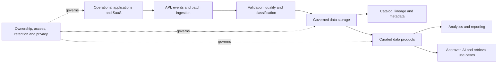

# 04 — Data Architecture

## 1. Data domains

| Domain | Example data | Accountable role (proposed) |
|---|---|---|
| Customer | Profile, preferences, interactions | Customer Data Owner |
| Product and service | Catalog, eligibility, pricing | Product Data Owner |
| Transaction | Orders, requests, service events | Operations Data Owner |
| Finance | Invoices, payments, budgets | Finance Data Owner |
| Workforce | Employee and organizational data | HR Data Owner |
| Technology and operations | Assets, services, incidents, costs | Technology Data Owner |
| Reference | Codes, classifications, hierarchies | Enterprise Data Governance |

## 2. Logical data architecture

## 3. Governance controls

- Assign a business owner and technical steward to critical data domains.
- Define data classification, purpose, lawful use, and retention.
- Measure quality using completeness, accuracy, consistency, timeliness, and uniqueness where relevant.
- Track lineage from source to report, data product, and AI use.
- Apply least-privilege access and segregation of duties.
- Establish data issue management and change notification.
- Document approved uses of sensitive and personal data.

## 4. Data product contract

Each proposed data product should document:

- Name, business purpose, and accountable owner.
- Source systems and refresh frequency.
- Schema, definitions, and quality expectations.
- Classification, permitted use, and access policy.
- Lineage, retention, and deletion requirements.
- Availability expectation and support contact.

## 5. AI and data governance

Retrieval-augmented generation and agentic workflows must use approved sources, enforce access controls at retrieval time, respect source permissions, and provide traceability. Model prompts and outputs should be handled under the same data classification and retention principles as other enterprise information.

## 6. Validation questions

- Which data domains are authoritative?
- Who can approve access and secondary use?
- Are definitions consistent across business units?
- Can critical reports and AI outputs be traced to source data?
- Which retention and deletion obligations apply?
