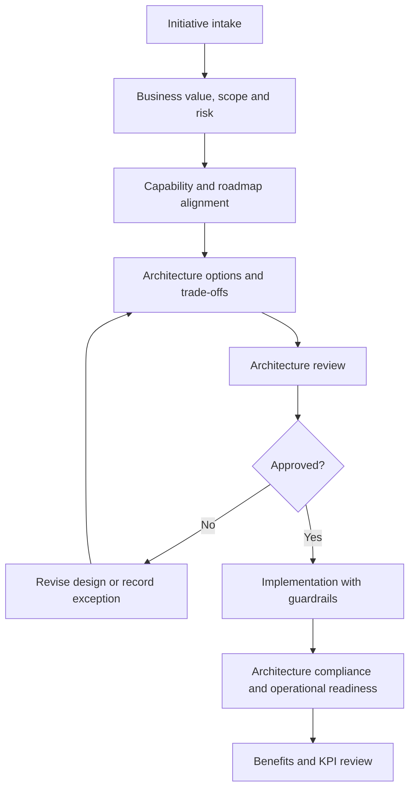

# 06 — Architecture Governance and Transformation Roadmap

## 1. Governance operating model

| Forum / role | Responsibility |
|---|---|
| Executive sponsor | Owns business outcomes and investment direction |
| Architecture Review Board | Reviews material architecture decisions and exceptions |
| Enterprise Architect | Maintains cross-domain coherence and target-state traceability |
| Domain / Solution Architects | Design within enterprise principles and standards |
| Security and risk | Reviews threat, control, privacy, and compliance concerns |
| Data governance | Owns data definitions, stewardship, and access policies |
| Product and business owners | Prioritize capabilities and validate outcomes |
| Platform and operations teams | Own runtime standards, SLOs, and operational readiness |
| Finance / FinOps | Owns cost allocation, budgets, and value reviews |

## 2. Architecture governance workflow

## 3. Proposed transition roadmap

This is a sequencing hypothesis for the fictional scenario. Actual timing depends on discovery, funding, dependencies, and delivery capacity.

| Transition | Focus | Example work packages | Exit evidence |
|---|---|---|---|
| T0 — Discover | Establish baseline | Stakeholder map, capability assessment, application/data inventory, risk baseline | Validated current-state views |
| T1 — Foundation | Governance and platform foundations | Architecture principles, identity baseline, landing-zone patterns, cost allocation | Approved standards and owners |
| T2 — Integrate | Reduce fragmentation | API/event patterns, data ownership, integration modernization | Governed interfaces and data contracts |
| T3 — Modernize | Improve priority value streams | Application modernization, workflow automation, platform engineering | Measured service and process outcomes |
| T4 — Optimize | Scale and improve | FinOps, analytics, responsible AI, resilience exercises | Benefits review and updated target state |

## 4. Architecture KPIs

Use baselines and owners before setting numerical targets.

- Percentage of strategic initiatives mapped to business capabilities.
- Percentage of critical applications with owners, lifecycle status, and recovery classification.
- Percentage of critical data domains with named owners and quality rules.
- API reuse and integration failure rates.
- Cloud cost allocation coverage and unit cost trends.
- Percentage of critical services with tested recovery procedures.
- Architecture decision lead time and exception aging.
- Adoption and measured benefit realization for transformation initiatives.

## 5. Architecture decision record template

Each material decision should capture:

- Context and problem statement.
- Drivers and constraints.
- Options considered.
- Decision and rationale.
- Security, data, operational, and financial implications.
- Risks, reversibility, and consequences.
- Owner, approval, and review date.

## 6. Governance safeguards

Architecture governance should enable delivery, not become an approval bottleneck. Use risk-based review, reusable reference patterns, clear decision rights, and time-bound exceptions.
